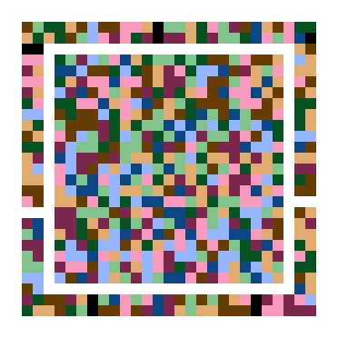

# LC Code

**L**uma / **C**hroma code — a colour 2D matrix symbology for **portable offline data
transmission**. Structured, JSON-shaped payloads at higher density than a monochrome
matrix code, read from a phone screen or from print, with no network involved at any
point.

Reference implementation of [`lc-code-spec-v0.4.md`](lc-code-spec-v0.4.md), in Rust,
shipped as a **WebAssembly component**.

**263 tests, zero warnings.** `just test`

---

## What it looks like



Three finder bullseyes and an alignment marker do the geometry — rendered at the two luma
levels of a single hue state, so detection works before any colour processing exists. On
a colour profile that means one hue's dark/light pair rather than black and white: a
four-colour palette has no neutral pair to use, and borrowing black and white would put
the fixed patterns outside the palette, giving the detector luma centroids that do not
match the payload's. What detection actually needs is the 1:1:3:1:1 run ratio in luma,
which holds regardless of hue.

The colour carries the payload: a luma layer at full module pitch and a chroma layer at
equal or coarser pitch, with independent code rates. The outer ring is the optional §6.4 reference border, a
calibration target for the illumination fit.

[`examples/`](examples/) has a symbol for each of seven representative payloads, plus one
per profile, each as PNG, SVG and the source JSON. Every one is decoded before it is
written, so anything there reads back to the JSON beside it.

## Why not just use a QR code

Density, and graceful failure. LC Code targets **1.5–2.0 bits/module** against monochrome's
1.0 — measured at **1.73×** on this implementation — so payloads that would need an
unreasonably large QR code fit in a scannable symbol.

The trade is deliberate. JAB Code reaches ~3 bits/module; LC Code spends the difference on
operating margin, because the impairments that actually break colour codes on a phone
screen are severe: specular glare, panel refresh beating against a rolling shutter, moiré,
and display colour modes that shift the whole palette. Two design choices follow:

- **The luma layer alone is a complete monochrome code.** Lose chroma entirely — bad light,
  a monochrome sensor — and you still get a result rather than a hard failure.
- **Colour errors are correlated across space, not independent.** A shadow or a glare
  highlight moves a whole region coherently, so ~2% of the symbol area spent on scattered
  known-colour references buys a fitted correction surface that cancels most of it.

## Quick start

```bash
just              # list every recipe
just test         # the whole suite
just component    # build both wasm components into dist/
just gallery      # regenerate examples/
```

Requires a Rust toolchain, plus [`just`](https://github.com/casey/just),
[`wasm-tools`](https://github.com/bytecodealliance/wasm-tools) and `zstd`.

`just hooks` points git at `.githooks`, whose `pre-push` runs `just ci`. Pre-**push**
rather than pre-commit on purpose: the gate builds two components and runs the suite in
release mode, which is too slow to sit between `git commit` and your prompt.

### From Rust

```rust
use lc_encode::EncodeOptions;
use lc_render::{RenderOptions, render_rgb};
use lc_decode::Decoder;

// Author in JSON, transmit CBOR (§9.4).
let sym = lc_encode::encode_json(
    r#"{"name":"Fred","loc":"45.00,55.0"}"#,
    &EncodeOptions::screen(),
)?;

let img = render_rgb(&sym, &RenderOptions::screen());

let out = Decoder::new().decode_rgb(&img.data, img.width, img.height, img.width * 3)?;
if let lc_core::Packet::Unsigned { body, .. } = out.packet {
    let value = lc_core::cbor::Value::from_slice(&body)?;
    println!("{}", lc_core::json::to_json(&value));
}
```

### From any WebAssembly host

The deliverable is a **component**, not a browser bundle. The interface is declared in
[`crates/lc-wasm/wit/lc.wit`](crates/lc-wasm/wit/lc.wit) and host bindings are generated
from it, so a host in Rust, Go, C or C++ adds support with no native dependency and no
hand-written ABI.

```
just component

dist/lc-code.wasm          decode + encode   282,508 bytes   (103,617 zstd)
dist/lc-code-scanner.wasm  decode only       192,046 bytes    (68,771 zstd)
```

```wit
export lc:code/decoder@0.4.0;   // decode, plus a multi-frame accumulator resource
export lc:code/encoder@0.4.0;   // encode-json / -text / -bytes / -json-svg
```

**Neither component imports anything from its host.** The single `import lc:code/types`
is a types-only interface — zero functions, nothing to provide. No WASI, no clock, no
randomness, no filesystem. It instantiates anywhere a Component Model runtime exists, and
that is asserted rather than assumed: `instantiates_with_an_empty_linker` loads both
components into wasmtime with a linker containing literally nothing.

Two builds because §14.1 keeps the encoder out of a scanner, so one cannot be acquired by
accident.

`just c-host` builds and runs a **C host** (`examples/c-host/main.c`) against the wasmtime
C API — encode and decode in one process, from a host sharing none of the guest's idioms.
Note that **Go cannot host a component yet**: `wasmtime-go` ships a component-capable C
library its Go API does not expose, and `wazero` is core-wasm only. See D9.

`just wasm-size` gates the scanner at **93% of §14.2's 200 KB budget**, measured **raw**.
The spec says "gzipped" because it assumed a browser bundle fetched over a network; a
component is loaded from disk, so uncompressed size is what has to fit. That distinction
is worth 60 percentage points here — the same artifact is 33% of budget compressed — so
the compressed figure would report headroom that does not exist.

## Layout

| Crate | State | Tests | What it is |
|---|---|---|---|
| `lc-core` | ✅ | 139 | Geometry, palette, ECC, container, masking, modulation |
| `lc-decode` | ✅ | 79 | §12 pipeline: detect, illuminate, demodulate, decode |
| `lc-encode` | ✅ | 11 | §8 pipeline; auto version, auto compression, mask search |
| `lc-render` | ✅ | 12 | SVG, RGB raster, PNG, ANSI terminal preview |
| `lc-wasm` | ✅ | 22 | The WIT component surface, plus 5 run under wasmtime |
| `lc-verify` | ⬜ | — | §10 signing. Optional, and not started |
| `lc-ffi` | ⬜ | — | C ABI for native embedders |
| `lc-cli` | ⬜ | — | Dev tool |
| `xtask` | ✅ | — | Table generation that must call into the crates |

Signing is **opt-in and not the point** (§1.2). Most payloads are expected to be unsigned
structured data — a config blob, a pairing token, a contact record — and an unsigned CBOR
payload pays ~4 bytes of framing and nothing else.

## Automation

Two layers, split by whether a task needs the project's own types:

- **`justfile`** — shell-shaped orchestration: builds, size gates, artifact generation.
  `just --list` is the front door.
- **`xtask`** — tasks that must call into the crates. `capacity` recomputes the §6.1 table
  from `lc_core::capacity` rather than restating it; `ldpc` generates the §8.2 base graphs,
  which the spec forbids building at runtime. No command runner can do either.

The justfile wraps xtask, so `just ldpc` and `just capacity` work and xtask stays an
implementation detail.

## Read before contributing

- **[`docs/decisions.md`](docs/decisions.md)** — every `[TBD]` pinned, and **nine places
  the implementation departs from the spec or the ecosystem forced a choice**, each with
  its reason and the test that locks it in. Two are provisional and want sign-off: the
  palette (D1/D2) and the illumination model (D3).
- **[`PROGRESS.md`](PROGRESS.md)** — what is built, what is left, and what was fixed.

The spec is a **draft**, not a frozen format. Sections marked `[NORMATIVE]` define the wire
format and must be settled before v1.0; the §8.2 ECC rates in particular are still the
spec's guesses and are the last thing blocking a freeze.

## Status

Encode and decode are complete and round-trip end to end through a rendered image. The §15
degradation harness is built, and the operating envelope is measured rather than asserted —
perspective, shading, specular glare, display colour modes, sensor noise, defocus, 4:2:0
subsampling, and multi-frame combining all have tests that name the claim they check.

Not done: signing, the C ABI, the CLI, fuzz targets, a frozen golden-vector file, and the
print palette. See [`PROGRESS.md`](PROGRESS.md).

## Licence

Apache-2.0. See [Appendix B](lc-code-spec-v0.4.md#appendix-b--prior-art-and-licensing) of
the spec for prior art — JAB Code, HCCB, and the EU DCC's COSE/CWT container — and read it
before publishing anything commercial.
