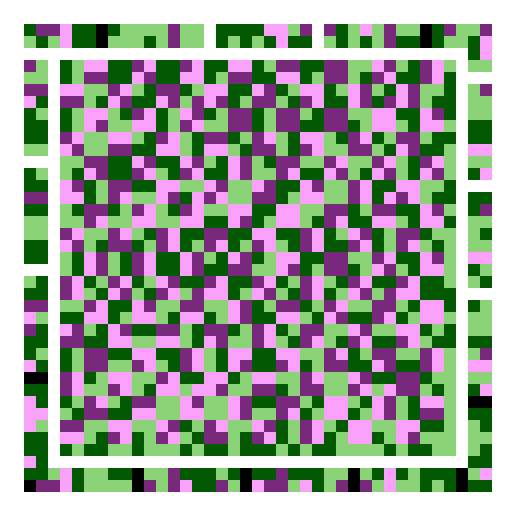
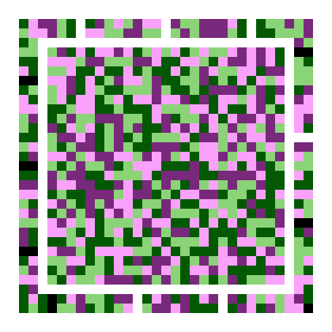

# LCR Code

**L**uma / **C**hroma / **R**ing code — a colour 2D matrix symbol for **portable offline data transmission**. It is possible to compress CBOR payloads at higher density than a monochrome matrix (QR) code will allow. No network needed.

**This project was mostly generated using AI (Claude Opus 5/5.5 and OpenAI Astra 6).** There is no intent to hide this fact. The project is being reviewed, corrected, and updated by humans.

A Reference implementation of [`lcr-code-spec-v0.4.md`](docs/lcr-code-spec-v0.4.md) is provided in Rust. Find the releases on GitHub as **WebAssembly components**, C libraries, or Rust binaries.

---

## What it looks like

The same 150-byte payload in three colour profiles, drawn to the same scale (12 px per
module), so the size difference is the density difference:

<table>
  <tr>
    <td align="center" valign="bottom"><br><b>C3</b> · 8 colours · 21×21</td>
    <td align="center" valign="bottom"><br><b>C2</b> · 4 colours · 33×33</td>
    <td align="center" valign="bottom"><br><b>C1</b> · 4 colours · 25×25</td>
  </tr>
</table>

[`examples/`](examples/) has a symbol for each of seven representative payloads, plus one
per profile, each as PNG, SVG, GDF (experimental), and the source JSON.

## How It Works

LCR codes do not use Reed-Solomon ECC. They instead use LDPC (Low-Density Parity Checks) and the main benefit is the "soft" decisions it allows vs RS. What this means is erasure rather than error. We could use that "softness" recover "glared" out sections, or help the decoder decide between two colours it can't quite read, because of lighting or skew. 

Please consult the "anatomy" examples **[`examples/anatomy-c3.md`](examples/anatomy-c3.png)**, **[`examples/anatomy-expanded-c3.png`](examples/anatomy-expanded-c3.png)**, and **[`examples/anatomy-ldpc-c3.png`](examples/anatomy-ldpc-c3.png)** for much more detail.


## Source Layout

| Crate | State | What it is |
|---|---|---|
| `lcr-core` | ✅ | Geometry, palette, ECC, container, masking, modulation |
| `lcr-decode` | ✅ | §12 pipeline: detect, illuminate, demodulate, decode |
| `lcr-encode` | ✅ | §8 pipeline; auto version, auto compression, mask search; §10 issuing |
| `lcr-render` | ✅ | SVG, RGB raster, PNG, ANSI, GDF (experimental) terminal preview |
| `lcr-wasm` | ✅ | The WIT component surface, plus tests run under wasmtime |
| `lcr-verify` | ✅ | §10 offline verification: COSE_Sign1, CWT claims, ES256 + Ed25519. Optional |
| `lcr-cft` | ✅ | CBOR File Transfer ([`docs/CFT.md`](docs/CFT.md)): chunked, hash-verified file transfer over any carrier, LCR Code symbols included |
| `lcr-ffi` | ✅ | C ABI: the component's surface as a static or shared library, with a generated header |
| `lcr-cli` | ✅ | The `lcr` command: encode, decode, probe, capacity, and file transfer from images |
| `xtask` | ✅ | Table generation that must call into the crates |

Two integration guides, for opposite hosts:

- **[`WASM-PLAN.md`](docs/WASM-PLAN.md)** — a host you control. No JavaScript, no WASI, no host
  imports at all.
- **[`FIREFOX.md`](docs/FIREFOX.md)** — a stock browser, with camera capture. `just web`
  transpiles the component and serves it.

**[`docs/explainer.html`](docs/explainer.html)** is the illustrated walkthrough — what the
luma and chroma layers actually are, what a decibel means here, how the profiles compare,
and what each kind of damage does. Open the `explainer.html` in a browser.

## Just use a QR code, or a JAB code, or a CIMBAR, or a...

LCR codes are differentiated from [CIMBAR](https://github.com/sz3/libcimbar) and [Microsoft's HCCB](https://en.wikipedia.org/wiki/High_Capacity_Color_Barcode) by the use of the ring for alignment, colour calibration, AND payload, LDPC instead of Reed-Solomon for "soft decisions", and a CBOR + compression scheme that can encode up to 34Kb (so far, likely greater) with a highly compressible file. 

The original inspiration was [JAB code](https://github.com/jabcode/jabcode). Take the concept of colours further and then add compression, move alignment out of the main symbol (and make the barcode itself an alignment "bullseye"), and **assume it is read on screens** rather than printed out on paper. The original goal was to transfer 5kb, and now that that has been surpassed, the new target is 50kb payloads consistently. 

LCR codes are meant to be an alternative where one can send the payload **directly from screen to screen**, with a good quality camera, instead of transferring over a network or needing an (ever-changing) endpoint. Why bother with a transient URL when you can just encode a JSON or CBOR?

Density, and graceful failure. LCR Code targets **1.5–2.0 bits/module** against monochrome's
1.0 — measured at **1.73×** on this implementation — so payloads that would need an
unreasonably large QR code fit in a scannable symbol.

**You can now check this claim yourself**, run `just web` and open
`http://localhost:8000/display.html`, which draws a QR of the same payload beside the LCR symbol at the same module pitch and reports the ratio. QR generation is the `qrcodegen` crate and the test
suite reads the result back with `rqrr`, an independent decoder, so the thing being
compared against is a real QR symbol.

Be careful what the ratio means, because it moves with the pairing. On a 50-byte CBOR
payload, against `C1` at ECC level 1:

| | QR-L | QR-M | QR-Q | QR-H |
|---|---:|---:|---:|---:|
| QR grid | 29×29 | 33×33 | 37×37 | 41×41 |
| area vs LCR Code's 29×29 | **1.00×** | 1.29× | 1.63× | 2.00× |

So LCR Code is *level with* QR at its weakest error correction and pulls ahead as QR's
strengthens. The bits/module figure above and the area figure here are different
measurements and only the second is what a user sees. Note also that LCR Code is carrying
far more redundancy than QR-L in that tie — ECC level 1 is a luma rate of 0.75 — so the
honest summary is that the two symbologies are close at small payloads and the gap opens
with size and with error correction, not that LCR Code is uniformly 1.73× anything.

The trade is deliberate. JAB Code reaches ~3 bits/module; LCR Code spends the difference on
operating margin, because the impairments that actually break colour codes on a phone
screen are severe: specular glare, panel refresh beating against a rolling shutter, moiré,
and display colour modes that shift the whole palette. Two design choices follow:

- **The luma layer alone is a complete monochrome code.** Lose chroma entirely — bad light,
  a monochrome sensor — and you still get a result rather than a hard failure.
- **Colour errors are correlated across space, not independent.** A shadow or a glare
  highlight moves a whole region coherently, so ~2% of the symbol area spent on scattered
  known-colour references buys a fitted correction surface that cancels most of it.

## Quick start

```bash
just              # list every recipe
just test         # the whole suite
just component    # build both wasm components into dist/
just gallery      # regenerate examples/
just deny         # dependency licences and RustSec advisories (needs cargo-deny)
just web          # run the illustrative example, needs a concurrent "cloudflared tunnel --url http://localhost:8000" for full example.
```

Requires a Rust toolchain, plus [`just`](https://github.com/casey/just),
[`wasm-tools`](https://github.com/bytecodealliance/wasm-tools), `zstd`, and
[`cbindgen`](https://github.com/mozilla/cbindgen) (`cargo install --locked cbindgen`) for
the C header check. On x86 and x86_64 the CLI's AVIF support also needs `nasm`.

`just hooks` points git at `.githooks`, whose `pre-push` runs `just pre-push`: formatting,
clippy and the test suite. GitHub Actions runs the full `just ci` on every push, adding the
debug-assertion pass, the wasm size gate and the C API checks. Pre-**push** rather than
pre-commit on purpose: the suite builds two components and runs optimised, which is too
slow to sit between `git commit` and your prompt.

### From the command line

```bash
cargo install crates/lcr-cli                 # installs `lcr`

lcr encode -d '{"name":"Fred"}' -o fred.png  # JSON goes on the wire as CBOR
lcr encode -d '{"name":"Fred"}' -o fred.gdf  # or .svg; .gdf is a one-page GDF document
lcr encode notes.txt                         # no -o: a preview in the terminal
lcr decode photo.jpg                         # prints {"name":"Fred"}
lcr decode --combine f1.png f2.png f3.png    # multi-frame (§12.4)
lcr decode --json photo.jpg                  # payload plus diagnostics, as JSON
lcr capacity                                 # bytes per version and profile

lcr send report.pdf -o symbols/              # a file as a sequence of symbols
lcr receive symbols/*.png                    # any order; names what is missing
lcr send big.zip -o frames/ --fountain       # a carousel: any ~K of its frames will do (feature `fountain`)
```

`lcr decode` reads PNG, JPEG, WebP, JPEG XL and AVIF. lcr decode picks the format from the file's contents, **not its extension**. This can be a gotcha, but was intended to avoid security issues.

Each image format is a separate cargo feature, so a smaller build can
drop what it does not need. HEIC (the iPhone camera's default), GIF, BMP, TIFF and camera
RAW, JPEG 2000, PSD and PDF are recognised but not read: `lcr` names the format and prints
the command that converts that file to PNG — `sips` on macOS, ImageMagick elsewhere.

### From C

`crates/lcr-ffi` builds `liblcr_ffi` (static and shared) with the header
[`include/lcr.h`](crates/lcr-ffi/include/lcr.h): the same surface as the WebAssembly
component, minus QR comparison. Every call returns a status, `lcr_last_error()` explains a
failure, and everything the library returns has a matching `_free`.
[`tests/smoke.c`](crates/lcr-ffi/tests/smoke.c) is the shortest complete example, and
`just ffi-test` builds and runs it.

### From Rust

```rust
use lcr_encode::EncodeOptions;
use lcr_render::{RenderOptions, render_rgb};
use lcr_decode::Decoder;

// Author in JSON, transmit CBOR (§9.4).
let sym = lcr_encode::encode_json(
    r#"{"name":"Fred","loc":"45.00,55.0"}"#,
    &EncodeOptions::screen(),
)?;

let img = render_rgb(&sym, &RenderOptions::screen());

let out = Decoder::new().decode_rgb(&img.data, img.width, img.height, img.width * 3)?;
if let lcr_core::Packet::Unsigned { body, .. } = out.packet {
    let value = lcr_core::cbor::Value::from_slice(&body)?;
    println!("{}", lcr_core::json::to_json(&value));
}
```

### From any WebAssembly host

The deliverable is a **component**, not a browser bundle. The interface is declared in
[`crates/lcr-wasm/wit/lcr.wit`](crates/lcr-wasm/wit/lcr.wit) and host bindings are generated
from it, so a host in Rust, Go, C or C++ adds support with no native dependency and no
hand-written ABI.

```
just component

dist/lcr-code.wasm          decode + encode
dist/lcr-code-scanner.wasm  decode only    
```

```wit
export lcr:code/decoder@0.4.0;   // decode, plus a multi-frame accumulator resource
export lcr:code/encoder@0.4.0;   // encode-json / -text / -bytes / -json-svg
```

**Neither component imports anything from its host.** The single `import lcr:code/types`
is a types-only interface — zero functions, nothing to provide. No WASI, no clock, no
randomness, no filesystem. It instantiates anywhere a Component Model runtime exists, and
that is asserted rather than assumed: `instantiates_with_an_empty_linker` loads both
components into wasmtime with a linker containing literally nothing.

Two builds because §14.1 keeps the encoder out of a scanner, so one cannot be acquired by
accident.

`just c-host` builds and runs a **C host** (`examples/c-host/main.c`) against the wasmtime
C API — encode and decode in one process, from a host sharing none of the guest's idioms.
Note that **Go cannot host a component yet**: `wasmtime-go` ships a component-capable C
library its Go API does not expose, and `wazero` is core-wasm only. See D9.

`just wasm-size` gates the scanner at **93% of §14.2's 200 KB budget**, measured **raw**.
The spec says "gzipped" because it assumed a browser bundle fetched over a network; a
component is loaded from disk, so uncompressed size is what has to fit. That distinction
is worth 60 percentage points here — the same artifact is 33% of budget compressed — so
the compressed figure would report headroom that does not exist.

Signing is **opt-in and not the point** (§1.2). Most payloads are expected to be unsigned
structured data — a config blob, a pairing token, a contact record — and an unsigned CBOR
payload pays ~4 bytes of framing and nothing else.

## Automation

Two layers of automation are present:

- **`justfile`** — shell-shaped orchestration: builds, size gates, artifact generation.
  `just --list` is the front door.
- **`xtask`** — tasks that must call into the crates. `capacity` recomputes the §6.1 table
  from `lcr_core::capacity`. `ldpc` generates the §8.2 base graphs,
  which the spec forbids building at runtime. No command runner can do either.

The justfile wraps xtask, so `just ldpc` and `just capacity` both work, and xtask stays an
implementation detail.

## Read before contributing

- **[`docs/decisions.md`](docs/decisions.md)** — every `[TBD]` pinned, and lists all changes and decisions, each with
  its reason and the test that locks it in. Two are provisional and want sign-off: the
  palette (D1/D2) and the illumination model (D3).

The spec is a **draft**, not a frozen format. Sections marked `[NORMATIVE]` define the wire
format and must be settled before v1.0; the §8.2 ECC rates in particular are still the
spec's guesses and are the last thing blocking a freeze.

## Status

Encode and decode are complete and round-trip end to end through a rendered image. The §15
degradation harness is built, and the operating envelope is measured rather than asserted —
perspective, shading, specular glare, display colour modes, sensor noise, defocus, 4:2:0
subsampling, and multi-frame combining all have tests that name the claim they check.

## License

The code is available under your choice of [MIT](LICENSE-MIT),
[Apache-2.0](LICENSE-APACHE) or the [Unlicense](UNLICENSE). Apache-2.0 is the option that
carries an explicit patent grant.

Unless you state otherwise, any contribution you submit for inclusion is offered under the
same three licences, with no additional terms.

The specification, [`lcr-code-spec-v0.4.md`](docs/lcr-code-spec-v0.4.md), is published under the
[Open Web Foundation Final Specification Agreement 1.0](https://www.openwebfoundation.org/the-agreements/the-owf-1-0-agreements-granted-claims/owfa-1-0),
which covers the text and gives implementers a royalty-free patent commitment. The author
holds no patents on the format and pledges never to assert any against a conforming
implementation.

See [Appendix B](docs/lcr-code-spec-v0.4.md#appendix-b--prior-art-and-licensing) of the spec for prior art — JAB Code, HCCB, and the EU DCC's COSE/CWT container — and read it before publishing anything commercial.
